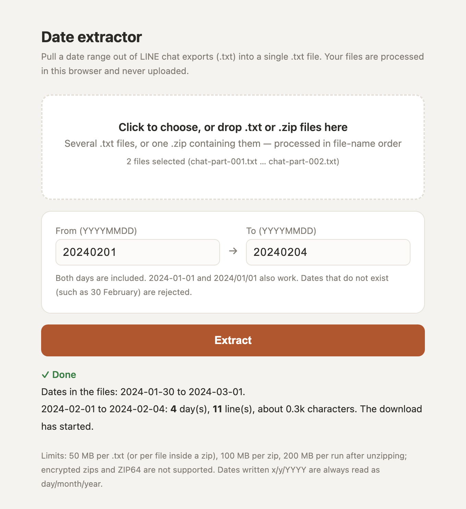
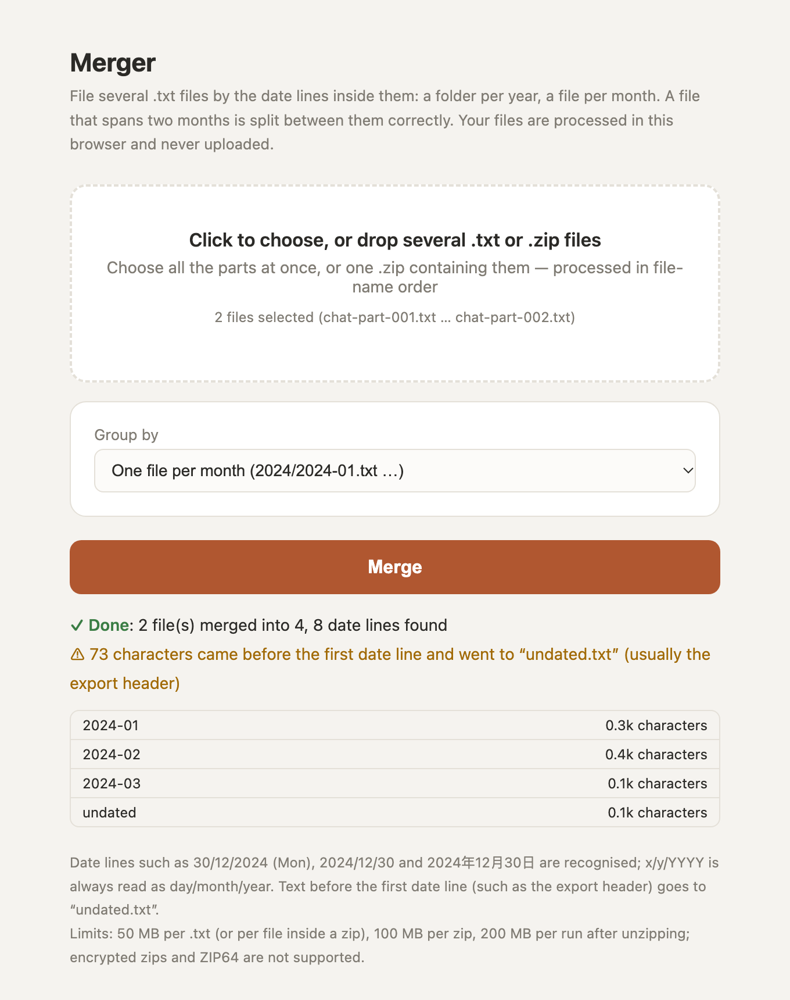
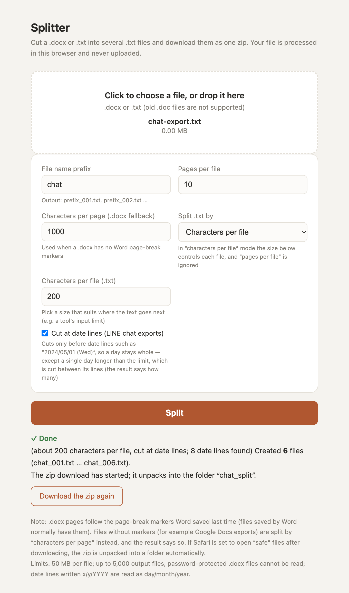

# LINE chat tools — extract, split and file chat exports, entirely in your browser

Three single-file tools for the plain-text chat history that LINE exports:

| Tool | Does | In | Out |
|---|---|---|---|
| [`date-extractor.html`](date-extractor.html) | Pull out a date range | several `.txt`, or a `.zip` of them | one `.txt` |
| [`splitter.html`](splitter.html) | Cut a long export into chunks | one `.txt` or `.docx` | `.zip` of `.txt` chunks |
| [`merger.html`](merger.html) | File everything by month or year | several `.txt`, or a `.zip` | `.zip`: `2024/2024-01.txt` … |

Open the HTML file, drop your files in, press the button. **The chats you choose are processed on your own device and
never uploaded** — chat logs are some of the most private data people have, so the whole design starts from that.

**Live demo:** <https://nullinbetween.github.io/line-tools/> — try it with the sample chats; anything you drop in stays in your browser.

[繁體中文說明 → README.zh-TW.md](README.zh-TW.md)

<table>
<tr>
<td width="33%"></td>
<td width="33%"></td>
<td width="33%"></td>
</tr>
<tr><td>Extractor: a range that spans two files</td><td>Merger: filed by month</td><td>Splitter: chunks cut at day boundaries</td></tr>
</table>

All screenshots use the fictional chats in [`examples/`](examples/).

---

## Design notes — how we thought about it

A LINE export is one long text file: a date line for each day, then that day's messages. People want three
things from it — *a slice* (“just February”), *chunks* (small enough to read, or to paste into an AI assistant
that has an input limit) and *an archive* (one file per month). Each tool does one of these.

| Decision | Why | Trade-off we accepted |
|---|---|---|
| **Everything runs in the browser, one HTML file each** | Nothing to install, nothing to trust on a server; a downloaded copy also works without a connection. | Bounded by browser memory — hence the limits below. |
| **The date line is the backbone** | Find the lines that are only a date — optionally with a weekday such as `(Tue)`, `（二）`, `Tuesday`, `星期二`, `火曜日` — and ranges, months and safe cut points all follow. Only real weekday names count; anything else after the date (`2024/03/01 day off`, `2024/03/01 Monsoon`) makes it a message. | A message that is *only* a date on its own line would still be read as a date line (documented). |
| **Detect the year by which number has 4 digits** | Exports differ by locale: `2024/01/30（二）` vs `30/01/2024（二）`. Hard-coding one order breaks the other. | `x/y/YYYY` is always read as day/month; US-style month/day lines are only caught when impossible (day > 12). |
| **A day carries over across files** | Long chats are often saved in parts, and a day can be cut in the middle. Files are processed in natural filename order (`part_2` before `part_10`), and the current date continues into the next file. | File names must sort in time order. |
| **Split between days where possible** | Every chunk stays readable on its own. A day alone over the limit is split between its lines, and only a single line longer than the limit is cut inside. Joining the chunks gives back the exact original. | Chunk sizes vary. |
| **A date must exist** | `2024/02/30` or `12/31/2024` must not silently start a new day. Such lines stay as content and are counted in the result. | — |
| **Duplicate file names: same content → use once; different content → stop and ask you to rename** | Dropping one silently loses data; guessing which comes first scrambles the order. | You may have to rename files. |
| **Hard limits and a zip-bomb guard** | 50 MB per file, 100 MB per zip, 200 MB total after unzipping; decompression stops the moment it passes the limit. A tab should not crash, and a small zip must not expand into gigabytes. | Very large archives need splitting first. |
| **No anonymisation is promised** | The original workflow paired these tools with a separate anonymiser. Doing that well is hard, and a half-working one gives false comfort, so it is not part of this release. | Protecting the output is up to you. |
| **Three small tools with a shared core** | Each file stands alone (open one HTML, done), so the core is deliberately copied into each — and a test fails if the three copies ever differ. | Duplicated code, kept in sync by a test. |

## Tutorial

### 1. Export a chat from LINE

On iPhone (labels vary between LINE versions and languages): open the chat → menu **≡** (top right) → **Other settings**
→ **Export chat history** → **Save to Files**. You get a `.txt` file; photos and videos are not included. Other platforms
have a similar *export chat history* option. Move the `.txt` to your computer.

No chat at hand? Use the fictional ones in `examples/` — `chat-part-001.txt` and `chat-part-002.txt` are one chat saved in
two parts, with 2024-02-01 cut across the two files.

### 2. Recipes

**Get one period out of a long chat** — `date-extractor.html`
1. Drop the `.txt` files (or a `.zip` containing them) on the box. The summary shows how many files were picked and in which order.
2. Type the range as `YYYYMMDD`, e.g. `20240201` → `20240204` (both ends included; `2024-02-01` also works).
3. Press **Extract**. You get `line_extracted_20240201-20240204.txt`; the result line tells you the date span found, days matched and lines written.

**Cut a long chat into chunks at day boundaries** — `splitter.html`
1. Drop one `.txt` chat export.
2. Leave **Split .txt by: Characters per file** on, set the size (default 3,500 characters), keep **Cut at date lines** ticked.
   Chunks then end only where a new day starts. A single day longer than the size is the exception: it is cut between
   messages (a single message longer than the size is cut by length, never inside a character), and the result says how
   many days were cut.
3. Press **Split**. You get `<prefix>_split.zip` with `<prefix>_001.txt`, `<prefix>_002.txt`, …

A `.docx` is split by pages instead, not by dates: **Pages per file** sets the size, using the page breaks Word saved
(or **Characters per page** when the file has none, e.g. a Google Docs export).

**File a chat by month** — `merger.html`
1. Drop all the parts (or a `.zip`).
2. Pick **One file per month** (or per year, or everything in one file).
3. Press **Merge**. You get `merged.zip` with `merged/2024/2024-01.txt`, …; text before the first date line (the export header) goes to `undated.txt`.

If something is off, the tools say so instead of guessing: impossible dates, duplicate names, oversized or encrypted zips,
old `.doc` files, more output files than the limit. Each message names the file and what to do.

## Limits

| | |
|---|---|
| Size | 50 MB per text file (or per file inside a zip) and per `.docx`; 100 MB per zip; 200 MB per run after unzipping; 5,000 zip entries; 5,000 output files |
| Zip | stored or deflate only; **no encrypted zips, no ZIP64**; every entry's CRC is checked |
| Word | `.docx` only (not `.doc`), not password-protected |
| Text encodings | UTF-8 (with or without BOM), UTF-16 with BOM, Big5 |
| Browsers | needs `DecompressionStream('deflate-raw')`: Chrome/Edge 103+, Safari 16.4+, Firefox 113+ |

The limits are constants (`LIMITS`) at the top of each file's core block. More in [`ISSUES.md`](ISSUES.md).

## Tests

```bash
python3 -m http.server 8765 --bind 127.0.0.1
```

- <http://127.0.0.1:8765/tests/core.test.html> — 47 tests: dates (leap years, impossible dates, both orders), cross-file
  days, messages that start with a date, encodings, duplicate names, zip formats and limits (crafted zips: deflate,
  encrypted, ZIP64, wrong size, wrong CRC, zip bomb),
  merging, splitting (lines kept whole when they fit, chunks join back to the exact original, emoji, flags and rare characters
  never cut in half, a day longer than the size counted and reported), `.docx` pages and tabs, output-file limits.
- <http://127.0.0.1:8765/tests/ui.test.html> — 8 tests that drive the three real pages in iframes (downloads are captured, not saved),
  including “while a new choice is being read, the previous one cannot be exported”.

## From personal tool to open source

These began as helpers in a larger personal workflow. For release we kept only the three general-purpose tools, and:

- added real calendar validation (the originals accepted 31 February, and the merger did not check days at all);
- replaced silent dropping of duplicate file names with “same → once, different → stop”;
- added size limits, ZIP64/encryption detection and a streaming zip-bomb guard (there were none);
- made all three decode text the same way (the merger only understood UTF-8) and escaped error messages;
- made length-based cuts keep lines whole when they fit and land on character boundaries otherwise (cutting by UTF-16
  units could split an emoji into “�”, and messages were cut mid-line), kept tabs
  from `.docx` files (they were being dropped), and capped the number of output files;
- removed every reference to the anonymiser, so the tools never imply they anonymise anything;
- wrote fictional sample chats and a test suite (unit + UI) that runs on them.

## How it was built

Designed by the author and written with AI coding assistants. The open-source preparation ran as a small multi-agent
workflow: **Codex** scoped the work and reviewed it independently, **Claude** made allowlisted copies, fixed defects and
wrote the tests and docs, and the author made the final calls.

## Licence

[MIT](LICENSE). No third-party code, fonts or data (see [`ASSET_REGISTER.md`](ASSET_REGISTER.md)).
LINE is a trademark of LY Corporation; this project is not affiliated with it and only reads the plain-text export format.

---

Made by [@nullinbetween](https://x.com/nullinbetween) · apps by meredith · [appsbymeredith.carrd.co](https://appsbymeredith.carrd.co)
